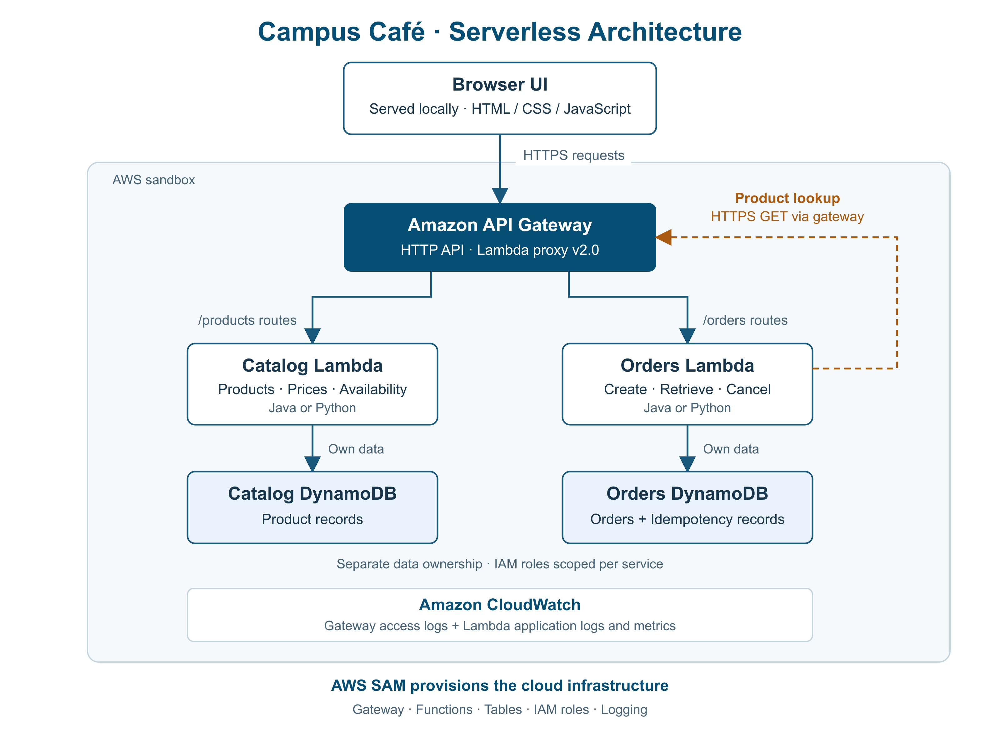

# Campus Café — Serverless Ordering Application

Ordering application for a campus café: a locally served web interface, **API Gateway HTTP API (payload 2.0)**, two **Python 3.13** Lambdas (Catalog and Orders), one DynamoDB table per service and logs in CloudWatch. All infrastructure is created with **AWS SAM** (`template.yaml`).



**Demo** — the local browser UI calling the deployed API:

https://github.com/user-attachments/assets/9d5d8ba3-3dea-425c-a212-0e6836cb9025

* API contract: [docs/openapi.yaml](docs/openapi.yaml) (OpenAPI 3.0).
* Design decisions (service and data boundaries, atomic idempotency, durable state, bounded Catalog call): [docs/DESIGN.md](docs/DESIGN.md).
* Actual check output and measurements against AWS: [docs/evidence/](docs/evidence/README.md).
* Demo video of the application working: [docs/evidence/demo-ui.webm](docs/evidence/demo-ui.webm).

## Structure

| Path | Contents |
|---|---|
| `template.yaml` | API, stage with access logs, 5 routes, 2 functions, 2 tables, log groups, least-privilege IAM, parameters |
| `samconfig.toml` | stack name and deployment options (no credentials) |
| `services/catalog/src/catalog_service/` | `handler.py` (2.0 event) → `domain/` (rules), `adapters/` (DynamoDB), `api/` (HTTP responses, logs) |
| `services/orders/src/orders_service/` | `handler.py` → `application/` (use cases) + `domain/` (rules) → `adapters/` (DynamoDB, Catalog over HTTPS); `api/` (HTTP, auth, logs) |
| `frontend/` | HTML/CSS/JS; `config.js` holds only the API URL |
| `seed/products.json` | 10 typical Colombian café products (COP in cents: `priceCents` 200000 = $2.000), 1 unavailable (jugo de lulo) |
| `scripts/` | seed, frontend configuration, local server, smoke test of the deployed API |
| `tests/` | unit, adapters (moto + local HTTP server), infra (template rules and OpenAPI conformance), `e2e/local_gateway.py` (tests only) |
| `docs/` | `architecture.png` (diagram), `openapi.yaml` (contract), `DESIGN.md` (design) and `evidence/` (smoke and evidence output against the deployed stack) |

## Requirements

* **To develop and test on your machine:** Python 3.12 or later. No AWS credentials needed.

  ```bash
  python3 -m venv .venv
  ```

  ```bash
  .venv/bin/pip install -r requirements-dev.txt
  ```

* **To deploy:** access to the AWS console. Deployment runs in **AWS CloudShell**, a terminal inside the console that already includes `aws` and `sam` and uses the session you signed in with. Credentials are **never** written to the repository or the chat.

## 1. Local automated tests (no AWS)

```bash
.venv/bin/python -m pytest
```

Runs the domain/service/handler unit tests, the real adapters against moto (DynamoDB) and against a local HTTP server (Catalog timeouts and retries), the template rules, and the OpenAPI document (valid OpenAPI 3.0, same routes as the template, schemas matching real responses).

## 2. Deployment with AWS SAM (from CloudShell)

This is the only deployment path. The same commands work in a local terminal if you have an AWS profile configured; in that case use `.venv/bin/python` instead of `python3`.

### 2.1 Package and upload the project

On your machine, build the package (without `.venv`, `.aws-sam` or caches):

```bash
zip -qr dist/campus-cafe.zip . -x '.venv/*' '.aws-sam/*' 'dist/*' '*__pycache__*' '.pytest_cache/*' '*.pyc' '.git/*'
```

In the AWS console, choose the region you will deploy to and open **CloudShell** (the `>_` icon in the top bar). Use **Actions → Upload file** to upload `dist/campus-cafe.zip`. Then, in CloudShell:

```bash
mkdir -p ~/campus-cafe && cd ~/campus-cafe && unzip -o ~/campus-cafe.zip
```

```bash
python3 -c "import boto3" || pip3 install --user boto3
```

boto3 is only used by the seed and verification scripts. The scripts work with Python 3.9 or later. The CloudShell home directory persists per region, but idle sessions are closed.

To **update** an existing deployment with a new zip, keep the `samconfig.toml` saved by `sam deploy --guided`, because it holds your `ExecutionRoleArn`. Then deploy without `--guided`:

```bash
cd ~/campus-cafe && unzip -o ~/campus-cafe.zip -x samconfig.toml
```

```bash
sam build && sam deploy
```

### 2.2 Check the account, region and tools

```bash
aws sts get-caller-identity
```

```bash
echo "$AWS_REGION"
```

```bash
sam --version
```

Declared runtime: `python3.13` (Globals → `Runtime`). It is the Python version CloudShell ships with, so `sam build` works there. According to the Lambda runtimes page it is supported on Amazon Linux 2023, with deprecation on June 30, 2029. Confirm your region in the [Lambda runtimes](https://docs.aws.amazon.com/lambda/latest/dg/lambda-runtimes.html) table. If the runtime were unavailable, changeset creation would fail before any resource is created.

### 2.3 Validate, build and deploy

**AWS Academy Learner Lab accounts:** the `voclabs` role does not allow `iam:CreateRole`, so the deployment fails when creating `CatalogRole` and `OrdersRole`. In that case the functions use the role the lab already provides, `LabRole`. Copy its ARN:

```bash
aws iam get-role --role-name LabRole --query Role.Arn --output text
```

Paste it when `sam deploy --guided` asks for `Parameter ExecutionRoleArn`. In an account that does allow creating roles, leave that parameter empty.

```bash
sam validate --lint
```

```bash
sam build
```

```bash
sam deploy --guided
```

* `sam build` needs a `python3.13` interpreter in the terminal; CloudShell has one. In a terminal without Python 3.13 it fails with "Binary validation failed for python". In that case delete `.aws-sam` and run `sam deploy` without `sam build`: the Lambdas have no external dependencies, and `sam deploy` packages `services/*/src` directly from `template.yaml`.
* If your SAM version does not accept `--lint`, use `sam validate`.

In guided mode accept the `campus-cafe` stack and the region, review the parameters and **read the changeset before confirming it**: it lists every resource and both IAM roles. The parameters are:

| Parameter | Default | Purpose |
|---|---|---|
| `FrontendOrigin` | `http://localhost:8080` | the only origin allowed by CORS |
| `LogRetentionDays` | `14` | retention of the 3 log groups |
| `LogLevel` | `INFO` | log level of both Lambdas |
| `CatalogTimeoutSeconds` | `2` | per-request timeout for Orders → Catalog |
| `CatalogMaxAttempts` | `2` | maximum attempts per product |
| `CatalogBudgetSeconds` | `5` | total budget for the Catalog lookup |
| `ExecutionRoleArn` | empty | empty = create the least-privilege roles; `LabRole` ARN = use that existing role (Learner Lab) |

Resulting IAM permissions (least privilege). Each function uses an explicit role (`CatalogRole`, `OrdersRole`) with no AWS managed policies. `AWSLambdaBasicExecutionRole` is not used, because it would allow writing to any log group.

* **CatalogFunction**: `dynamodb:GetItem` and `dynamodb:Scan` on `CatalogTable` only; `logs:CreateLogStream` and `logs:PutLogEvents` on its own log group only.
* **OrdersFunction**: `dynamodb:GetItem`, `dynamodb:PutItem` and `dynamodb:ConditionCheckItem` on `OrdersTable` only (the transaction is authorized through those actions); logs on its own log group only. It has no access to `CatalogTable`: it looks up products over HTTPS through the gateway.
* API Gateway can invoke each function only for its own routes (`AWS::Lambda::Permission` with `SourceArn`).

**Learner Lab limitation:** with `ExecutionRoleArn` pointing to `LabRole`, `CatalogRole` and `OrdersRole` are not created, and both functions use `LabRole`. That role has much broader permissions, so in that environment **least privilege at runtime is not met**. The restricted roles remain defined in the template, and the tests check that they are the default behavior. The `ExecutionRoleMode` output shows which mode was deployed, and `collect_evidence.py` shows the actual policies of the role in use.

**If a deployment fails:** the stack ends in `ROLLBACK_COMPLETE` and cannot be updated. Delete it with `sam delete --stack-name campus-cafe` before retrying. Because `OrdersTable` is retained, an orphan `campus-cafe-OrdersTable-*` table may remain. Find it with `aws dynamodb list-tables` and delete it with `aws dynamodb delete-table --table-name <name>`.

Stack outputs (names are generated by CloudFormation; there are no fixed names):

```bash
aws cloudformation describe-stacks --stack-name campus-cafe --query "Stacks[0].Outputs" --output table
```

`ApiUrl`, `CatalogTableName`, `OrdersTableName`, `ApiAccessLogGroupName`, `CatalogLogGroupName`, `OrdersLogGroupName`, `CatalogFunctionName`, `OrdersFunctionName`.

## 3. Seed the catalog

In CloudShell:

```bash
python3 scripts/seed_catalog.py --stack campus-cafe
```

It reads `CatalogTableName` from the stack outputs and validates each product with the same rules as the service.

## 4. Verify the deployed API

In CloudShell:

```bash
python3 scripts/smoke_test.py --stack campus-cafe
```

To keep the output as evidence, run it as `python3 scripts/smoke_test.py --stack campus-cafe | tee docs/evidence/smoke-$(date -u +%Y-%m-%dT%H%MZ).txt` and download the file.

It sends real requests to the deployed API:

* product list and detail;
* 5 concurrent identical creations, which must leave a single order;
* attempts to set the price or total from the client, and other invalid input (400);
* creation (201 + `Location`), replay (200, same body) and key conflict (409);
* unknown product (400) and unavailable product (409);
* lookup, repeated cancellation, 404s and CORS preflight.

It creates and cancels real orders.

### Quality attribute evidence

In CloudShell:

```bash
python3 scripts/collect_evidence.py --stack campus-cafe
```

The script writes `docs/evidence/evidence-<timestamp>.md`. Download it with **Actions → Download file** (path `campus-cafe/docs/evidence/...`). The report covers:

* **Reliability:** 5 concurrent identical creations that must produce a single stored order. After updating the Lambda configuration, it checks that the replay returns the same result.
* **Persistence:** the same order is read after the update.
* **Performance:** 3 warm-up reads and 20 sequential ones. It reports individual timings and p95, and cold starts separately, taken from the `REPORT ... Init Duration` lines.
* **Observability:** follows the creation's `apigw-requestid` from the gateway access log to the Orders logs (with `orderId`) and the Catalog logs (`correlationId`).
* **Fault isolation:** temporarily points Orders' `CATALOG_BASE_URL` to an unreachable URL: first a DNS failure, then a timeout. It checks for the 503 response and that neither the order nor the idempotency record is stored.
* **Security:** inspects `config.js` and the actual policies of each role.

The script **temporarily** changes the Orders function environment, outside CloudFormation, and always restores it when it finishes. A later `sam deploy` also resets it. Your user needs `lambda:UpdateFunctionConfiguration`, `logs:FilterLogEvents`, IAM read access and `dynamodb:Scan`/`GetItem` on the orders table.

## 5. Local web interface

In CloudShell, copy the API URL:

```bash
aws cloudformation describe-stacks --stack-name campus-cafe --query "Stacks[0].Outputs[?OutputKey=='ApiUrl'].OutputValue" --output text
```

On your machine, paste it into `frontend/config.js` (`apiBaseUrl: "https://…"`; it is not a secret) and start the interface:

```bash
scripts/serve_frontend.sh
```

Open http://localhost:8080. Each order gets a short code such as `CC-7K3Q-9XMD`, which can be searched in lowercase or without dashes. That origin must match `FrontendOrigin`. If you use another port, redeploy with `--parameter-overrides FrontendOrigin=http://localhost:PORT`.

If you have a local AWS profile, `scripts/configure_frontend.sh campus-cafe` writes `config.js` automatically.

## 6. Logs and metrics

In CloudShell:

```bash
sam logs --stack-name campus-cafe --name OrdersFunction --tail
```

```bash
aws logs tail "$(aws cloudformation describe-stacks --stack-name campus-cafe --query "Stacks[0].Outputs[?OutputKey=='ApiAccessLogGroupName'].OutputValue" --output text)" --follow
```

Orders publishes the `OrdersCreated`, `IdempotentReplays` and `DependencyFailures` metrics in the `CampusCafe` namespace, using Embedded Metric Format.

## 7. Cleanup

`OrdersTable` has `DeletionPolicy: Retain` so orders survive redeployments and stack deletion. In CloudShell, save its name **before** deleting the stack:

```bash
ORDERS_TABLE=$(aws cloudformation describe-stacks --stack-name campus-cafe --query "Stacks[0].Outputs[?OutputKey=='OrdersTableName'].OutputValue" --output text)
```

```bash
sam delete --stack-name campus-cafe
```

`sam delete` removes the API, the functions, `CatalogTable`, the roles and the log groups. The retained table is deleted by hand, irreversibly:

```bash
aws dynamodb delete-table --table-name "$ORDERS_TABLE"
```

* If you no longer have the table name, find it with `aws dynamodb list-tables` (it starts with `campus-cafe-OrdersTable`).
* SAM also leaves the managed bucket `aws-sam-cli-managed-default-*` with the deployment artifacts. You can empty and delete it if you do not use it for other projects.
* Files uploaded to CloudShell are removed with `rm -rf ~/campus-cafe ~/campus-cafe.zip`.

## Local test harness

`tests/e2e/local_gateway.py` runs the real handlers behind a minimal HTTP API 2.0 emulator, with moto DynamoDB, to try the interface without credentials. It is **for testing only**: it is not deployed and does not replace API Gateway, Lambda or DynamoDB.

```bash
.venv/bin/python tests/e2e/local_gateway.py
```
