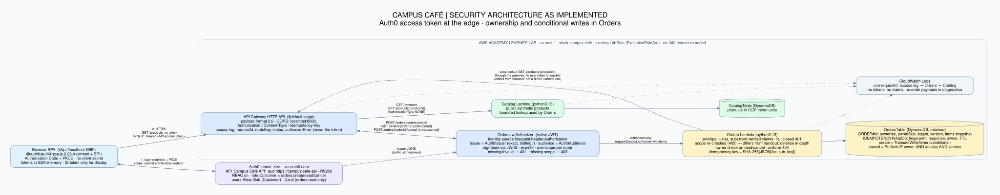
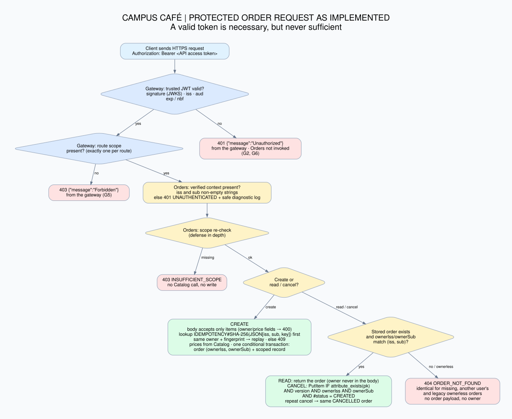

# Security workshop — submission index

Campus Café with an identity and authorization boundary: Auth0 (SPA + PKCE), the API Gateway HTTP API JWT authorizer, and ownership enforced in Orders. Branch `feature/auth0-security`; the graded baseline stays on `main`.

| Document | Contents |
|---|---|
| [verification.md](verification.md) | Results table G1–G6, S1–S10, A1–A5 with environment, test or command, and PASS / NOT RUN |
| [adr-001-identity-and-authorization.md](adr-001-identity-and-authorization.md) | Architecture decision record (the six questions) |
| [staff-tenant-design.md](staff-tenant-design.md) | Design question: café staff and catalog maintainers (not implemented) |
| [ai-use.md](ai-use.md) | AI-use note |
| [architecture.svg](architecture.svg), [authorization-flow.svg](authorization-flow.svg) | Diagrams of the implementation (Graphviz sources next to them) |
| [../evidence/](../evidence/README.md) | Executed outputs: smoke test, quality evidence, local test run |

Differences from the handout's expected diagram: Orders reads prices through the gateway's public `GET /products/{productId}` (the baseline design), not by calling the Catalog Lambda directly; and Orders re-checks the route scope after the gateway (defense in depth).

## Route-to-scope mapping

| Route | Gateway | Orders |
|---|---|---|
| `GET /products`, `GET /products/{productId}` | `AuthorizationType: NONE` (public, synthetic) | — |
| `POST /orders` | JWT + `orders:create` | scope re-check; owner = caller |
| `GET /orders/{orderId}` | JWT + `orders:read` | scope re-check; owner match or uniform 404 |
| `POST /orders/{orderId}/cancel` | JWT + `orders:cancel` | scope re-check; owner match; conditional write on owner, status and version |

The same table lives in `template.yaml`, `services/orders/src/orders_service/api/auth.py` (`ROUTE_SCOPES`) and `docs/openapi.yaml`; tests fail if they differ.

## Owner and idempotency schema (OrdersTable, single table)

| Item | Key `pk` | Security attributes |
|---|---|---|
| Order | `ORDER#<orderId>` | `ownerIss`, `ownerSub` (verified `iss`, `sub`; absent on legacy orders → nobody can access them), `status`, `version` |
| Idempotency record | `IDEMPOTENCY#<SHA-256(JSON [iss, sub, Idempotency-Key])>` | `ownerIss`, `ownerSub`, `fingerprint`, `orderId`, `responseBody` (original creation response), `expiresAt` (TTL, `IdempotencyTtlHours`) |

**Scoped key.** `json.dumps([iss, sub, key], separators=(",", ":"))`, UTF-8, SHA-256 hex (64 characters). The header itself must match `^[A-Za-z0-9_.:-]{8,128}$`.

**Canonical request hash (fingerprint).** Computed from the *accepted* body after validation: only `items` is allowed, each line exactly `productId` (lowercase UUID) and `quantity` (integer 1–10), no duplicates, 1–10 lines. The lines are sorted by `productId` and serialized as `[[productId, quantity], …]` with `separators=(",", ":")`, then hashed with SHA-256. Key order, whitespace and line order in the client's JSON do not change it. Prices, totals and anything the server computes are not part of it. Ownership and price fields are rejected (400), not ignored.

## Limitations

- **Lab role, not least privilege:** both functions run with the shared AWS Academy `LabRole`. The least-privilege roles are defined in the template and tested statically, but not deployed.
- **Direct invocation** of the Orders function with lab credentials (bypassing the authorizer) was not tested; the Lambda permissions only restrict API Gateway's `SourceArn`.
- **Token revocation:** an access token stays valid until it expires (Auth0 default 24 h) after logout; the API does not check revocation.
- **Session restore** fails in browsers that block third-party cookies (Brave): users log in again with one click. Tokens were deliberately kept in memory, not in `localStorage`.
- **Not run:** A1, A2, A4 (no signed fixtures), A3 partially (only through G6), S10 against the deployed stack.
- **Local evidence** uses fabricated trusted-context events, and the local harness emulates the authorizer without signature checks; neither demonstrates the cloud boundary.
- **Public repository:** the evidence includes the AWS account ID, Learner Lab policy names and the Auth0 tenant domain (no credentials or tokens).
- Not production-ready: no custom Auth0 domain, refresh-token rotation, rate limiting, WAF or staff/tenant roles.

## Demonstration order

1. Public menu without login; Alice logs in (user card shows her permissions) and creates an order.
2. Alice reads it; Bob, logged in a separate browser profile, gets 404 reading and cancelling it (`smoke_test.py` G4).
3. Same-key replay returns the original order; a changed body with the same key gets 409 (S5).
4. Bob uses Alice's client key and gets his own order (S6).
5. One reliability check (five concurrent creates → one order, S7) and one limitation (`LabRole`).
